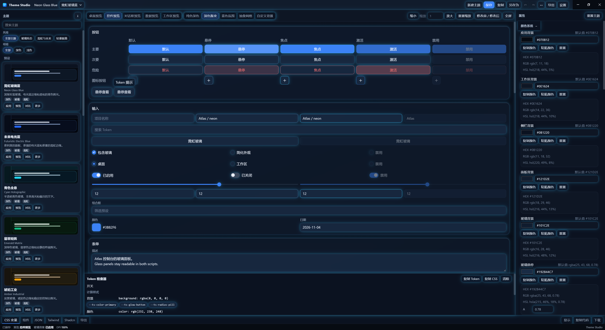
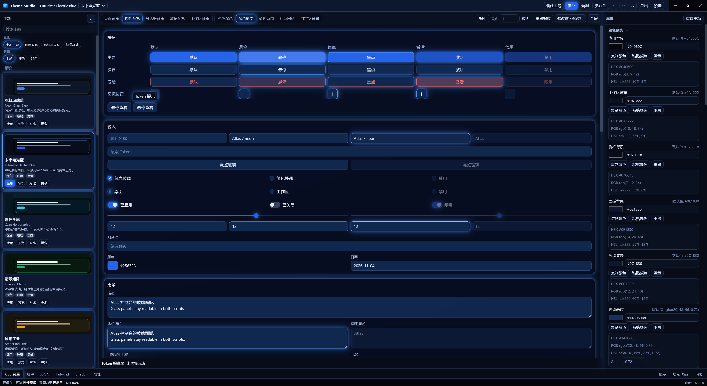
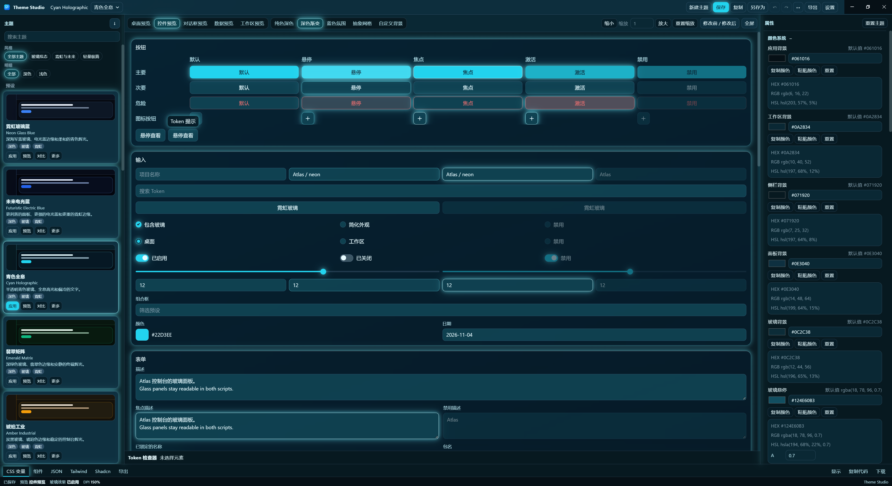
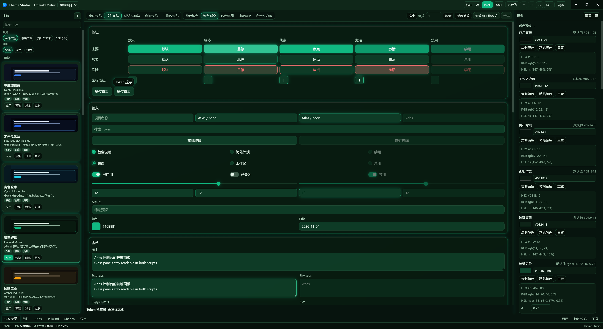
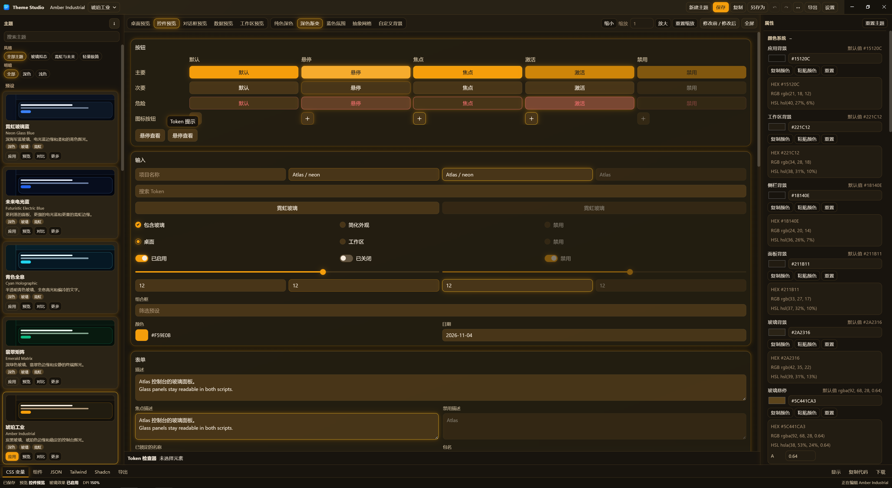

# Theme Studio

[中文](README.zh-CN.md)

Desktop app for designing and checking UI themes on this machine. Edit color, glass, glow, border, shadow, type, radius, and motion, look at the controls in the preview, then export JSON, CSS, Tailwind CSS v4, shadcn/ui, and a ZIP.

Version **1.0.0**. Application id `com.themestudio.desktop`. It does not talk to any other product.

When this file and `docs/` disagree, the source in `src/` and `electron/` is the one to follow. `docs/archive/` is a snapshot from 2026-10-31.

## Screenshots

Components preview. In each shot, the shell and the preview both use that theme.

### Neon Glass Blue

The token inspector is open.



### Futuristic Electric Blue



### Cyan Holographic



### Emerald Matrix



### Amber Industrial



## What you can do

- Theme library: 17 presets, saved themes, favorites, recent themes, search, and filters for style and light or dark. Create, duplicate, rename, delete, import, save, and save as.
- A theme that is still named Untitled Theme opens a save dialog. A theme that already has its own name saves directly. Save As always makes a copy.
- Recent themes can be hidden in Settings. Turning the switch off hides the group and stops recording new opens. The stored list remains.
- Property editor: color, glass, glow, border, shadow, type, radius, and animation. The color section edits 18 color fields. The document stores 22. Border color, width, opacity, radius, and the active, hover, and focus colors are edited in the border section.
- Preview scenes: Desktop, Components, Dialog, Data, and Workspace. You can change the backdrop, zoom the preview, and focus the preview.
- The title-bar theme restyles the application shell. It does not replace the theme open in the preview.
- Compare two themes, undo and redo (100 steps), click a preview control to read its computed style, and open the token panel to read the export source.
- Languages: Simplified Chinese and English. The setting can follow the system. Switching language changes display names, descriptions, and categories only. Theme JSON and CSS variable names stay as stored.

Neon Glass Blue is the default preset. Preset documents store the English name.

## Presets

Order is the `PRESETS` array in `src/theme-engine/presets/index.ts`. Style and light or dark tags come from `src/theme-engine/presets/catalog.ts`. Those tags are not written into theme JSON. Filters combine with AND.

| Id | Name | Style | Mode |
| --- | --- | --- | --- |
| `neon-glass-blue` | Neon Glass Blue | glass, neon | dark |
| `futuristic-electric-blue` | Futuristic Electric Blue | glass, neon | dark |
| `cyan-holographic` | Cyan Holographic | glass, neon | dark |
| `emerald-matrix` | Emerald Matrix | glass, neon | dark |
| `amber-industrial` | Amber Industrial | glass, neon | dark |
| `cyberpunk-violet` | Cyberpunk Violet | glass, neon | dark |
| `minimal-dark-blue` | Minimal Dark Blue | glass, lightweight | dark |
| `aurora-glass` | Aurora Glass | glass | dark |
| `arctic-frost` | Arctic Frost | glass | light |
| `dark-glass-professional` | Dark Glass Professional | glass | dark |
| `obsidian-mono` | Obsidian Mono | glass | dark |
| `nordic-light` | Nordic Light | glass | light |
| `pure-white` | Pure White | lightweight | light |
| `soft-gray` | Soft Gray | lightweight | light |
| `warm-sand` | Warm Sand | lightweight | light |
| `mist-blue` | Mist Blue | lightweight | light |
| `sage-calm` | Sage Calm | lightweight | light |

Every preset uses small, medium, and large radii of 8 / 10 / 14, and a control radius of 8. Extra-large and pill radii stay with each preset. Shell and preview corners use `corner-shape: superellipse(2)`. Shell control borders are 0.5px. Preview borders use the theme's own border width.

## Export

A package contains `theme.json`, `variables.css`, `components.css`, `tailwind.css`, `shadcn.css`, and `README.md`. The same files can be written on their own, and the package can be zipped.

`variables.css` emits 62 `--ts-*` variables. Schema version is 1. There is no migrator. A file with another `schemaVersion` is rejected.

## Stack

Electron 45.2.1, electron-vite 6, React 19.3.1, TypeScript 5.9.3, Vite 8.3.5, Tailwind CSS 4.3.3, Radix primitives, Zustand 5, i18next 26, JSZip 3, electron-builder 26. Node `>=22`. pnpm 11.9.0.

The package stays CommonJS. Do not set `"type": "module"` in `package.json`.

The renderer does not receive `fs` or a raw `ipcRenderer`. File access goes through the preload bridge, `window.themeStudio`. The window uses `contextIsolation`, `sandbox`, and `webSecurity`, with `nodeIntegration` off.

## Develop

```bash
pnpm install
pnpm dev
```

`pnpm start` opens the built pages with electron-vite preview. Use `pnpm dev` while editing.

```bash
pnpm typecheck
pnpm lint
pnpm test
pnpm build
pnpm dist
```

`pnpm build` writes `out/main`, `out/preload`, and `out/renderer`. `pnpm test` runs Vitest.

## Windows package

`pnpm dist` builds an unsigned NSIS installer and an unpacked app:

- `release/Theme Studio-Setup-1.0.0.exe`
- `release/win-unpacked/Theme Studio.exe`

The installer lets you choose a directory, installs for the current user, and does not delete user data on uninstall. Themes are stored in `%APPDATA%\theme-studio\themes\`. Development and the packaged app share that folder.

If the Electron or NSIS download from GitHub fails, set the mirrors and pack again:

```powershell
$env:ELECTRON_MIRROR='https://npmmirror.com/mirrors/electron/'
$env:ELECTRON_BUILDER_BINARIES_MIRROR='https://npmmirror.com/mirrors/electron-builder-binaries/'
pnpm dist
```

electron-builder 26 needs `@electron/get` 5. That override lives in `pnpm-workspace.yaml`, not in the `pnpm` field of `package.json`.

## Layout

- `electron/main` and `electron/preload`: window, menu, and file IPC
- `src/`: the editor, library, and preview
- `src/theme-engine`: presets, tokens, validation, and export
- `tests/`: engine and i18n checks
- `docs/`: longer notes. The archive there is older than the source
