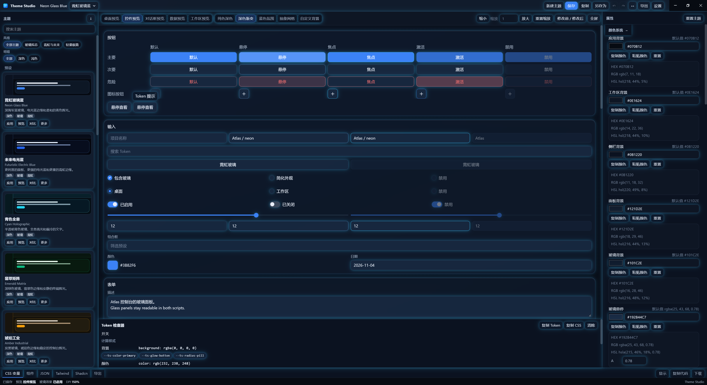
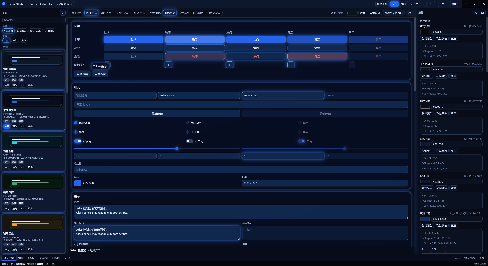
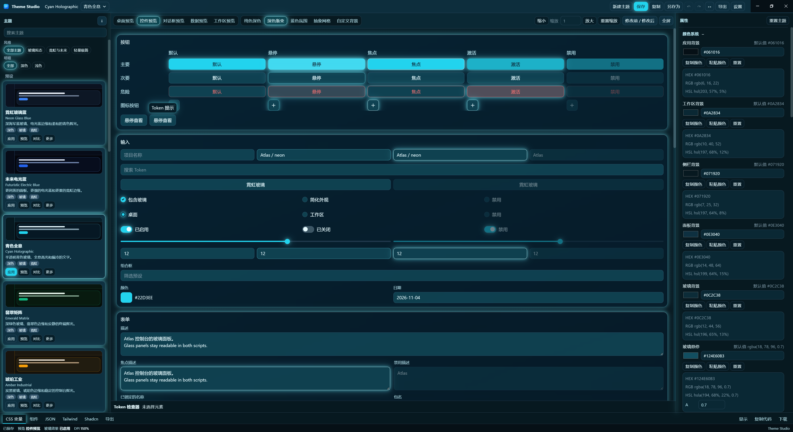
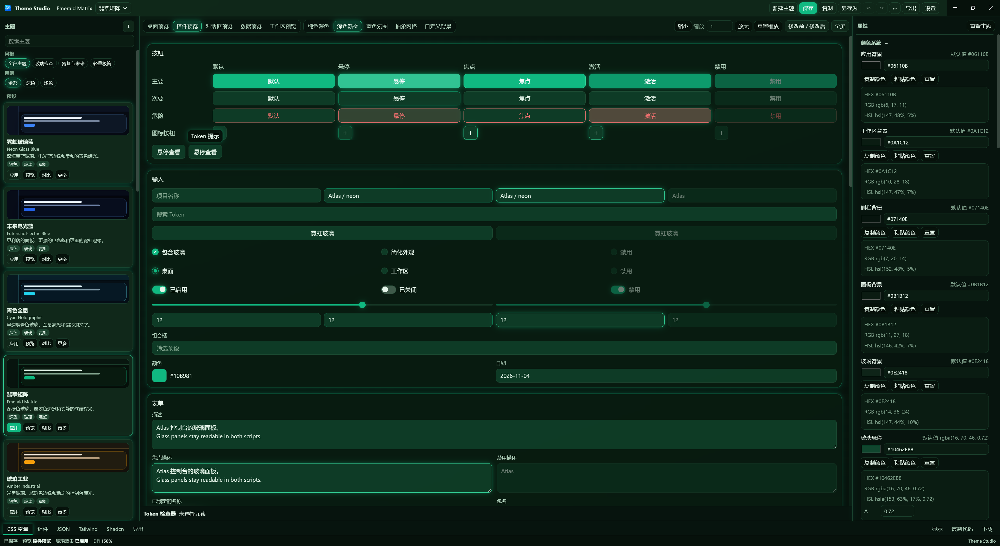
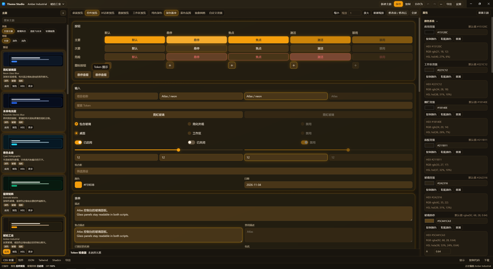

# Theme Studio

[English](README.md)

本机上的主题设计与调试工具。编辑颜色、玻璃、发光、边框、阴影、字体、圆角和动画，在预览里看控件，再导出 JSON、CSS、Tailwind CSS v4、shadcn/ui 和 ZIP。

当前版本 **1.0.0**。应用 ID `com.themestudio.desktop`。它不依赖其他产品进程。

本说明和 `docs/` 不一致时，以 `src/` 与 `electron/` 里的源码为准。`docs/archive/` 是 2026-10-31 的盘点。

## 界面

控件预览。每一张里，外壳和预览都切到了这一套主题。

### 霓虹玻璃蓝

Token 检查器是打开的。



### 未来电光蓝



### 青色全息



### 翡翠矩阵



### 琥珀工业



## 能做什么

- 主题库：17 套预设、已保存主题、收藏、最近使用、搜索，以及风格和明暗筛选。可以新建、复制、重命名、删除、导入、保存和另存为。
- 名称仍是「未命名主题」时，保存会弹出保存框。已经有自己名称的主题直接保存。另存为始终复制一份。
- 设置里可以关闭最近使用。关闭后这一组隐藏，之后的打开和保存不再写入。已经记下的列表还在。
- 属性栏：颜色、玻璃、发光、边框、阴影、字体、圆角、动画。颜色区编辑 18 个颜色字段，主题文档里有 22 个。边框颜色、宽度、透明度、圆角，以及激活、悬停、焦点颜色在边框区编辑。
- 预览场景：桌面、组件、对话框、数据、工作区。可以换背景、缩放预览、聚焦预览。
- 标题栏主题只改变外围软件，不替换预览里打开的主题。
- 可以对比两套主题，撤销和重做（100 步），点击预览控件查看计算样式，在底栏查看导出源码。
- 语言：简体中文和 English。设置里可以跟随系统。切换语言只改显示名称、描述和分类。主题 JSON 和 CSS 变量名保持原样。

默认预设是霓虹玻璃蓝（Neon Glass Blue）。写进主题文件的预设名称是英文。

## 预设

顺序是 `src/theme-engine/presets/index.ts` 里的 `PRESETS`。风格和明暗标签在 `src/theme-engine/presets/catalog.ts`，不写入主题 JSON。筛选条件同时生效。

| Id | 中文名 | 英文名 | 风格 | 明暗 |
| --- | --- | --- | --- | --- |
| `neon-glass-blue` | 霓虹玻璃蓝 | Neon Glass Blue | 玻璃、霓虹 | 深色 |
| `futuristic-electric-blue` | 未来电光蓝 | Futuristic Electric Blue | 玻璃、霓虹 | 深色 |
| `cyan-holographic` | 青色全息 | Cyan Holographic | 玻璃、霓虹 | 深色 |
| `emerald-matrix` | 翡翠矩阵 | Emerald Matrix | 玻璃、霓虹 | 深色 |
| `amber-industrial` | 琥珀工业 | Amber Industrial | 玻璃、霓虹 | 深色 |
| `cyberpunk-violet` | 赛博紫 | Cyberpunk Violet | 玻璃、霓虹 | 深色 |
| `minimal-dark-blue` | 极简深蓝 | Minimal Dark Blue | 玻璃、轻量 | 深色 |
| `aurora-glass` | 极光玻璃 | Aurora Glass | 玻璃 | 深色 |
| `arctic-frost` | 极地霜 | Arctic Frost | 玻璃 | 浅色 |
| `dark-glass-professional` | 深色专业玻璃 | Dark Glass Professional | 玻璃 | 深色 |
| `obsidian-mono` | 黑曜单色 | Obsidian Mono | 玻璃 | 深色 |
| `nordic-light` | 北欧浅色 | Nordic Light | 玻璃 | 浅色 |
| `pure-white` | 纯白极简 | Pure White | 轻量 | 浅色 |
| `soft-gray` | 柔和灰 | Soft Gray | 轻量 | 浅色 |
| `warm-sand` | 暖沙色 | Warm Sand | 轻量 | 浅色 |
| `mist-blue` | 雾霾蓝 | Mist Blue | 轻量 | 浅色 |
| `sage-calm` | 鼠尾草绿 | Sage Calm | 轻量 | 浅色 |

17 套预设的小、中、大圆角都是 8 / 10 / 14，控件圆角是 8。超大档和胶囊仍按各套自己的值。外围和预览的圆角曲率是 `corner-shape: superellipse(2)`。外围控件边框是 0.5px。预览边框用主题自己的边框宽度。

## 导出

一套导出包含 `theme.json`、`variables.css`、`components.css`、`tailwind.css`、`shadcn.css` 和 `README.md`。这些文件也可以单独导出，整套可以打成 ZIP。

`variables.css` 写出 62 个 `--ts-*` 变量。Schema 版本是 1，没有迁移器。`schemaVersion` 不是 1 的文件会被拒绝。

## 技术栈

Electron 45.2.1、electron-vite 6、React 19.3.1、TypeScript 5.9.3、Vite 8.3.5、Tailwind CSS 4.3.3、Radix 原语、Zustand 5、i18next 26、JSZip 3、electron-builder 26。Node `>=22`。pnpm 11.9.0。

工程保持 CommonJS。不要在 `package.json` 里设置 `"type": "module"`。

渲染进程不接收 `fs` 或裸 `ipcRenderer`。文件访问经过预加载的 `window.themeStudio`。窗口开启 `contextIsolation`、`sandbox` 和 `webSecurity`，关闭 `nodeIntegration`。

## 开发

```bash
pnpm install
pnpm dev
```

`pnpm start` 用 electron-vite preview 打开已构建的页面。改代码时用 `pnpm dev`。

```bash
pnpm typecheck
pnpm lint
pnpm test
pnpm build
pnpm dist
```

`pnpm build` 写出 `out/main`、`out/preload`、`out/renderer`。`pnpm test` 运行 Vitest。

## Windows 安装包

`pnpm dist` 生成未签名的 NSIS 安装包和免安装目录：

- `release/Theme Studio-Setup-1.0.0.exe`
- `release/win-unpacked/Theme Studio.exe`

安装包可以选择目录，按当前用户安装，卸载时不删除用户数据。主题保存在 `%APPDATA%\theme-studio\themes\`。开发和打包后的程序共用这个目录。

如果从 GitHub 下载 Electron 或 NSIS 工具失败，先设置镜像再打包：

```powershell
$env:ELECTRON_MIRROR='https://npmmirror.com/mirrors/electron/'
$env:ELECTRON_BUILDER_BINARIES_MIRROR='https://npmmirror.com/mirrors/electron-builder-binaries/'
pnpm dist
```

electron-builder 26 需要 `@electron/get` 5。覆盖写在 `pnpm-workspace.yaml`，不要写进 `package.json` 的 `pnpm` 字段。

## 目录

- `electron/main`、`electron/preload`：窗口、菜单和文件 IPC
- `src/`：编辑器、主题库和预览
- `src/theme-engine`：预设、token、校验和导出
- `tests/`：引擎和语言测试
- `docs/`：更长的说明。其中的归档早于当前源码
